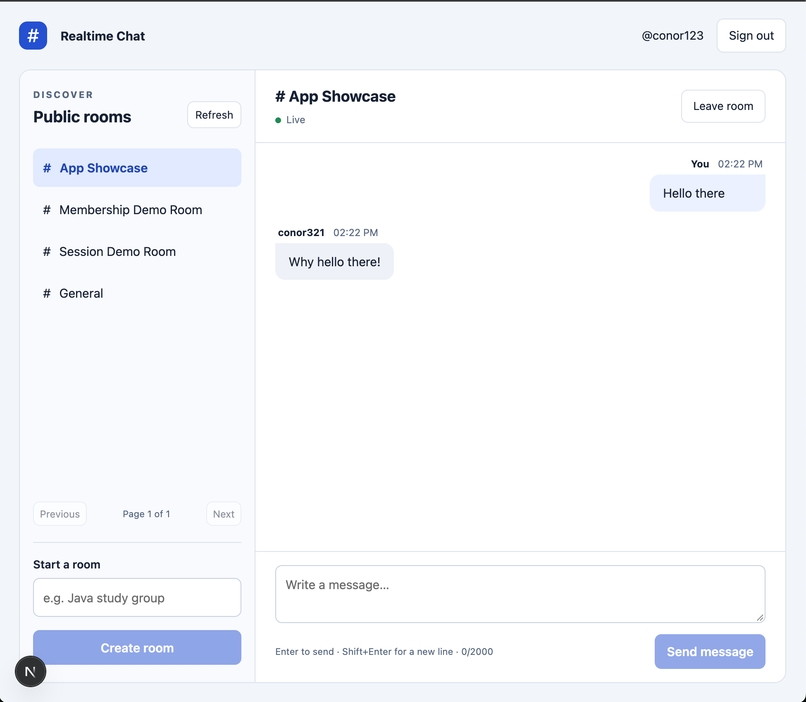

# Realtime Chat

A local full-stack chat application built with Java 21, Spring Boot, Spring Security, PostgreSQL, JPA/Hibernate, and Next.js/TypeScript.

Users register and sign in, browse public rooms, join or leave, exchange live text messages, and reload saved history. REST owns writes; a native WebSocket delivers committed messages. The frontend merges history, POST replies, and live events by message ID.




## Requirements

- JDK 21 and Maven 3.9.x
- Node.js 24 and npm
- Docker Desktop with Compose
- VS Code or another editor

Use `localhost` in browser URLs. The local ports are fixed:

| Service | Address |
| --- | --- |
| Next.js | http://localhost:3000 |
| Spring REST | http://localhost:8080/api |
| Room WebSocket | ws://localhost:8080/ws/rooms/{roomId} |
| PostgreSQL from the Mac | localhost:5433 |
| PostgreSQL inside its container | 5432 |

## Run locally

From the project root, in terminal A:

```bash
docker compose up -d --wait
cd backend
mvn spring-boot:run
```

From the project root, in terminal B:

```bash
cd frontend
npm ci
npm run dev
```

`npm ci` requires the committed `frontend/package-lock.json`. If assembling this project from the checkpoint guides, first run `npm install` after creating/updating `package.json`, then keep the generated lockfile. Use `npm ci` for later installs that match that lockfile.

Open http://localhost:3000. Create an account, then sign in. Use a normal browser window and a private window or separate profile for two different accounts; ordinary tabs share the session cookie.

The backend health check is http://localhost:8080/api/health. The backend root `/` has no page and can return 404; the interface is served by Next.js on port 3000.

## Run checks

With Docker Desktop running, from `backend`:

```bash
mvn clean verify -Pintegration
```

This runs unit tests and the `*IT` integration tests against temporary Testcontainers PostgreSQL databases. It does not use the development database. Inspect the summary for executed integration tests, zero failures/errors, and `BUILD SUCCESS`.

From `frontend`:

```bash
npm test
npm run lint
npm run typecheck
npm run build
```

The Node suite contains 17 tests. For the real browser test, keep PostgreSQL and Spring running, stop any process using frontend port 3000, and run from `frontend`:

```bash
npx playwright install chromium
npm run test:e2e
```

The test starts the previously built Next production server and stops that server afterward. It creates two uniquely named `e2e_` accounts, one room, and four saved messages in the development database. Those records remain for inspection. See [checkpoint 7](docs/CHECKPOINT_7.md) for expected results, manual persistence/reconnect checks, and debugging instructions.

## Packaged demonstration

Stop an existing Spring process before starting the packaged backend. From `backend`:

```bash
mvn package
java -jar target/chat-backend-0.0.1-SNAPSHOT.jar
```

Stop an existing Next development server. From `frontend`:

```bash
npm run build
npm start
```

PostgreSQL must remain running. Open the same localhost:3000 URL. `mvn package` alone does not run the `integration` profile; use the full verification command above before calling the project verified.

## Data and sessions

Flyway migrations V1–V4 create rooms, users, memberships, and messages. Hibernate validates their mappings at startup. Keep applied migrations unchanged; future schema changes get a new migration.

The `chat_pgdata` Docker volume retains database records across normal container stops/restarts. `docker compose down` retains that volume; adding `-v` deletes it. Use `docker compose stop` for an ordinary pause.

Sessions live in the Spring process. Restarting Spring ends current logins, so sign in again; accounts, memberships, and message history stay in PostgreSQL. The configured session timeout is 30 minutes. WebSocket traffic alone does not refresh the HTTP session's activity time.

## API summary

All paths below are relative to http://localhost:8080. Protected routes require the session cookie. POST and DELETE requests also require a CSRF token, including registration and login. Fetch `/api/auth/csrf` with the same cookie jar and send its returned `headerName` and `token`; obtain a new token after login.

| Method | Path | Success / purpose |
| --- | --- | --- |
| GET | `/api/health` | 200; public liveness JSON |
| GET | `/actuator/health` | 200 when healthy; includes database health |
| GET | `/api/auth/csrf` | 200; public CSRF bootstrap |
| POST | `/api/auth/register` | 201; JSON `{username,password}`; does not sign in |
| POST | `/api/auth/login` | 204; form-encoded `username` and `password` |
| GET | `/api/auth/me` | 200; signed-in account without its password hash |
| POST | `/api/auth/logout` | 204; invalidate session and clear cookie |
| GET | `/api/rooms?page=0&size=20` | 200; authenticated room listing |
| POST | `/api/rooms` | 201; JSON `{name}`; creator also joins |
| GET | `/api/rooms/{id}` | 200; authenticated public room details |
| GET | `/api/rooms/{id}/members/me` | 200; own membership status |
| POST | `/api/rooms/{id}/members/me` | 204; join |
| DELETE | `/api/rooms/{id}/members/me` | 204; leave |
| GET | `/api/rooms/{id}/messages?size=20&before=123` | 200; member-only message history |
| POST | `/api/rooms/{id}/messages` | 201; member-only JSON `{content}` |

Room pages are zero-based, newest room ID first, with sizes 1–50. History defaults to 20 messages and allows 1–50. Omit `before` for the latest page. History items arrive in descending ID order; `nextBefore` is an exclusive cursor for older messages. The frontend requests 50 and displays messages in ascending ID order.

Usernames contain 3–30 letters, digits, or underscores and are stored lowercase. Passwords contain 12–128 characters. Room names are trimmed, limited to 80 input characters, and unique ignoring case. Messages must be nonblank and contain at most 2000 Java string units; whitespace within an accepted message is preserved. The server determines sender identity, room association, and creation time.

Common errors include 400 validation, 401 authentication/bad credentials, 403 CSRF/membership, 404 missing room, and 409 duplicate username/room name. Known application errors return a problem JSON body with a `code`; body validation also supplies `fieldErrors`. A request with both missing authentication and missing CSRF can fail the CSRF filter first.

## Live event contract

Open `ws://localhost:8080/ws/rooms/{id}` from the allowed frontend origin with a valid login cookie and membership. Browser WebSockets attach the cookie automatically. The server sends JSON text frames:

```json
{"type":"ready","roomId":1}
```

```json
{"type":"message.created","message":{"id":42,"roomId":1,"senderId":7,"senderUsername":"alice","content":"Hello","createdAt":"2026-10-19T17:00:00Z"}}
```

The socket is receive-only; send messages through REST. Authentication/membership are checked at connection time and before each delivered event. Revoked connections close with policy code 1008 when checked. The frontend also closes its connection when leaving, signing out, or changing rooms. A server-side revocation does not promise an immediate close while the socket is idle.

## Structure and design

- `backend/src/main/java/com/example/chat`: controllers, services, repositories, security, and live delivery.
- `backend/src/main/resources/db/migration`: versioned SQL schema.
- `backend/src/test`: unit, PostgreSQL, HTTP/session, and WebSocket tests.
- `frontend/src/app`: Next page, layout, and CSS.
- `frontend/src/components`: account forms, rooms, and conversation UI.
- `frontend/src/lib`: API/session handling, message merging, and room connection state.
- `frontend/tests`: unit tests and `e2e/chat.spec.ts`.
- [Architecture and tradeoffs](docs/ARCHITECTURE.md)

## Scope and limits

This version targets one local backend instance and public text rooms. Sessions and live connections are held in memory; history is durable in PostgreSQL. Reconnect refreshes the loaded history window and deduplicates by ID. An uncertain send is reported without automatically repeating the write.

Direct messages, JWT, attachments, typing indicators, read receipts, moderation, rate limiting, shared sessions, a durable event outbox, and deployment are future work. Deploying publicly would require HTTPS, deployment-specific cookie/origin configuration, protected secrets, operational monitoring, and appropriate abuse controls. The current localhost credentials and HTTP configuration are demonstration defaults.

## Stop

Stop foreground Next and Spring processes with Ctrl+C in their respective terminals. From the project root:

```bash
docker compose stop
```