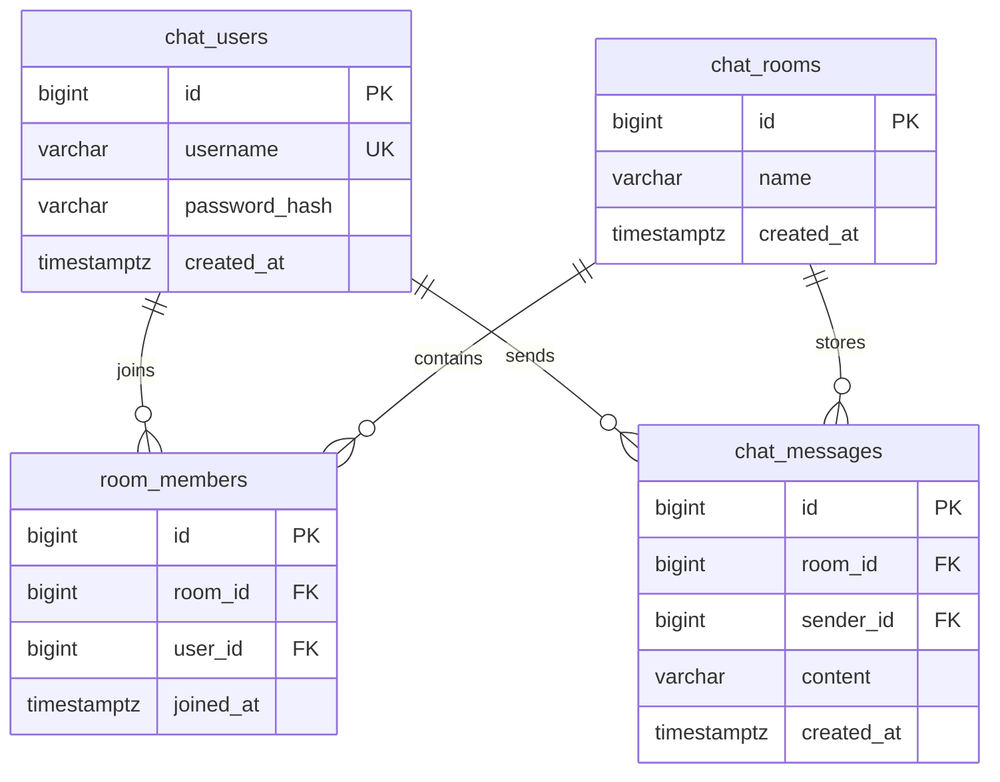

# Architecture and tradeoffs

## Technology requirements mapped to the implementation

| Requirement | Implementation | Evidence |
| --- | --- | --- |
| Spring Boot REST and WebSocket endpoints | Room/auth/message controllers and `/ws/rooms/{id}` | API integration tests and `LiveMessagingIT` |
| Spring Security authentication | Database-backed username/password login, cookie sessions, CSRF | `RegistrationApiIT`, `AuthSessionIT`, and delivery access tests |
| PostgreSQL through JPA/Hibernate | Entities/repositories with Flyway migrations V1–V4 | PostgreSQL integration tests and restart/history demonstration |
| Next.js live frontend | Client components, native socket adapter, room feed | 17 frontend unit tests and the real two-context browser test |

## Request and delivery flow

A controller translates HTTP input into a service call and returns a DTO. Services authorize operations, enforce business rules, and define transaction boundaries. Spring Data JPA repositories persist entities. PostgreSQL enforces uniqueness and foreign keys even when requests race.

For a message send:

1. Spring Security checks the login session and CSRF header.
2. `MessageService` checks room membership and resolves the sender from the authenticated principal.
3. JPA saves the message inside the database transaction.
4. An application event is published inside that transaction.
5. An `AFTER_COMMIT` listener broadcasts only after a successful commit.
6. Each recipient's current session and membership are checked before delivery.
7. The browser merges the live event and POST reply using the saved message ID.

A rollback does not announce a message. A committed message can survive a failed socket delivery. PostgreSQL history remains the recovery source; the broadcast itself is not a durable queue. A process failure after commit but before broadcast can delay visibility until history is refreshed or the client reconnects.

## Data model

Additional rules: a unique index on `lower(chat_rooms.name)`, a unique membership pair `(room_id,user_id)`, and an index on `(room_id,id DESC)` for history. Leaving deletes membership, not message history. Sender IDs remain linked to their accounts.

Flyway defines the actual schema and records which migrations ran. JPA annotations define how Java objects map to that schema. `ddl-auto=validate` checks agreement; `open-in-view=false` keeps database work within the intended application operations. These are complementary responsibilities.

## Authentication and room authorization

Spring Security verifies a salted PBKDF2-HMAC-SHA256 password hash through a versioned delegating encoder. Passwords are never returned in account DTOs. Login changes the session ID. The browser receives an HttpOnly `CHATSESSION` cookie with SameSite=Lax; JavaScript obtains a CSRF token through the API for state-changing requests.

Registration creates an account but does not log it in. Login is form-encoded, while ordinary application writes use JSON. The frontend refreshes the CSRF token after login. CORS permits credentialed browser requests from exactly `http://localhost:3000`; socket origins use the same frontend origin.

Authentication identifies the account; membership authorizes room message access. Signed-in nonmembers can browse public room details, but must join before reading history, sending, or opening that room's live connection. Clients do not choose a sender ID in message requests.

Both HTTP authorization and per-delivery socket checks matter. A handshake authorizes one point in time; logout, session expiry, or leaving can change access afterward. The UI clears data when leaving or detecting revoked access. An idle server socket may remain open until a later delivery/access check; it must not receive a new event after that check denies access.

Sessions are local to the backend process and expire after 30 minutes of HTTP inactivity. Restarting Spring requires signing in again; database records remain.

## Frontend state and recovery

Next's App Router supplies the page shell. Interactive forms and the room panel are Client Components. A per-room `RoomFeed` owns messages, cursor, membership, and socket lifecycle. React subscribes to immutable cached snapshots through `useSyncExternalStore`.

The feed opens its socket, waits for `ready`, and loads history while merging any events received during that read. It deduplicates by saved ID and sorts by ID. Lifecycle counters and abort signals prevent replies from a previous room/connection from overwriting current state.

Reconnect uses bounded delays and then offers a manual retry. Recovery scans backward to the oldest loaded message, preserving the older-history cursor. That fills gaps even when an isolated newer POST reply was already known. More loaded history costs more recovery reads.

A failed POST response can follow a successful database commit. This version does not automatically repeat uncertain writes; the user checks history before trying again. Exactly-once sending across arbitrary network failures would require a client-generated idempotency key and a server/database uniqueness rule.

## Decisions and alternatives

| Decision | Reason / tradeoff |
| --- | --- |
| Cookie sessions | Straightforward browser authentication and server-side logout; needs CSRF and shared session storage to scale across instances |
| Native receive-only WebSocket | One room connection with a small JSON contract; REST reuses existing validation, CSRF, transactions, and error responses |
| Public rooms with explicit membership | Clear authorization rule without private invitations or direct-message permissions |
| Versioned SQL plus JPA | Reviewable schema evolution with ordinary Java persistence mapping |
| DTOs rather than entity JSON | Stable API fields without exposing password hashes or lazy entity relationships |
| Cursor-based message history | Efficient bounded older-message reads using the room/ID index |
| Single backend process | Fits the project scope; multiple instances need shared sessions and cross-instance event distribution |
| No JWT or direct messages in core | The agreed authentication and live-room requirements are already met; both would add separate design/testing work |

## Remaining engineering limits

This is a local project/demo, with synchronous in-memory broadcasting and no durable delivery queue. Slow recipients, large rooms, multiple instances, event loss across process crashes, abuse controls, account recovery, and deployment need additional work.